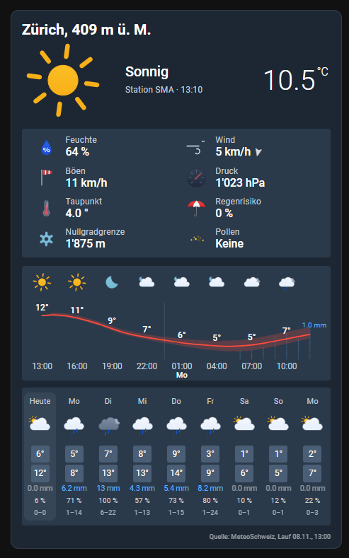
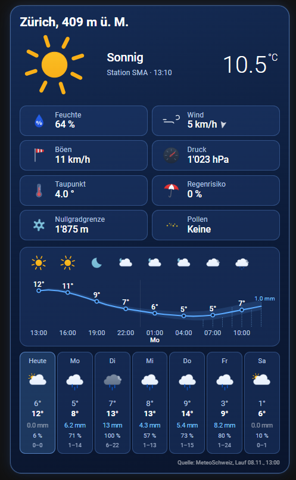
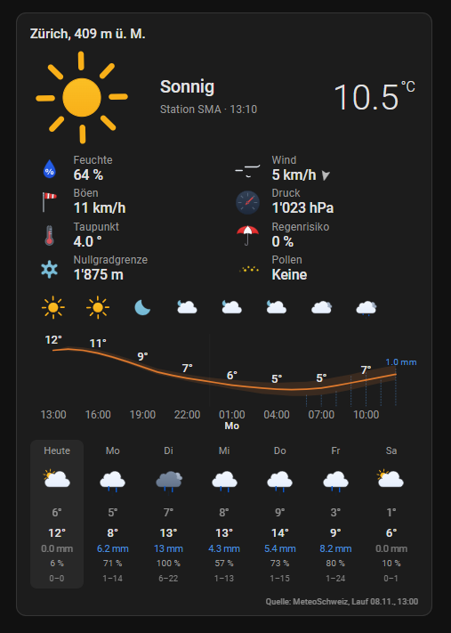
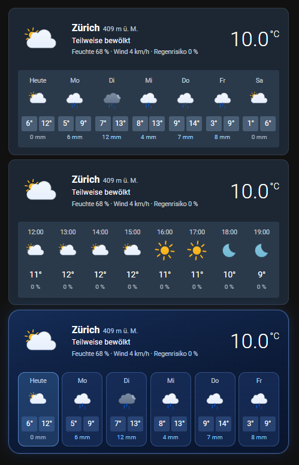
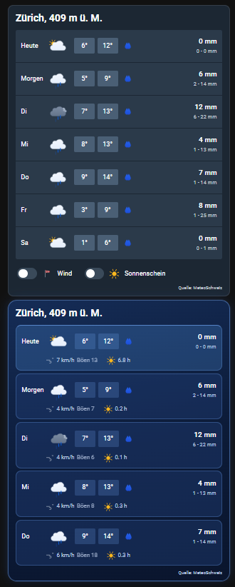
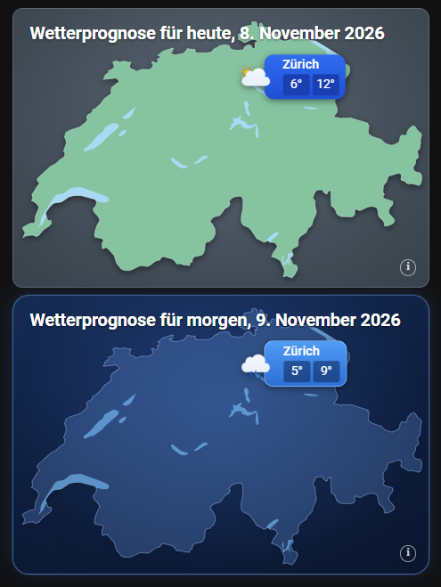
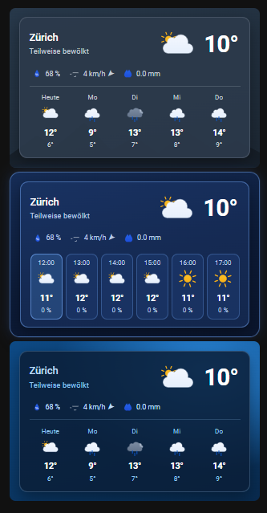
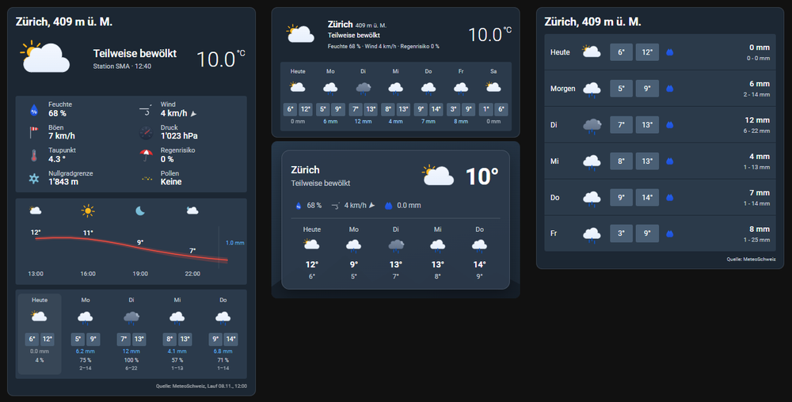

# Swiss Meteo for Home Assistant

[](https://hacs.xyz/docs/marketplace/)
[](LICENSE)
<a href="https://www.buymeacoffee.com/prusuino"></a>


A Home Assistant custom integration for the **MeteoSwiss** forecast and measurements, from the official open data: the local forecast of your postal code (nine days, hour by hour, with the uncertainty range), the live values of the nearest SwissMetNet station every ten minutes, and a dashboard card with animated icons — read so sparingly that the hourly forecast costs a few megabytes a day, not hundreds.

> **Open data only.** Everything comes from the files MeteoSwiss publishes under CC BY 4.0 on the federal geodata platform, plus the official warnings from MeteoAlarm (EUMETNET, CC BY 4.0), where MeteoSwiss publishes them. No app backend, no scraping, no API key, no third-party service, no Python dependencies.

## Highlights

- **Everything official, in one device**: the MeteoSwiss local forecast, the live values of a SwissMetNet station, the official warnings and the pollen counts — all from open data, read by one integration.
- **Reads sparingly**: a forecast parameter costs about 40 KB instead of the 33 MB file it lives in, thanks to range requests; the hourly forecast is a few megabytes a day, and a traffic sensor shows it.
- **Built for the automation editor**: triggers (rain expected, rain cleared, frost tonight, new run, warning issued, warning cleared), conditions (rain expected, dry, frost expected, warning in force) and ready-made blueprints — no templates needed.
- **Figures for heating and solar**: heating degree days, daily mean temperature, global radiation and sunshine sums for today and tomorrow, as sensors.
- **Rain and frost at a glance**: the next rain as a timestamp, "rain expected" for the coming hours, "frost tonight" for the garden.
- **Official warnings matched to your place**: the MeteoSwiss warnings (via MeteoAlarm) are tested against your forecast point itself, with a banner on the cards.
- **Pollen with the MeteoSwiss load classes**: seven species from the nearest of the 15 pollen stations.
- **Decades of station history**: one action imports the station's archive (hourly since 1980, daily since the station started) into the long-term statistics.
- **Five dashboard cards**: hourly chart with uncertainty bands, nine-day strip, daily list, map of Switzerland, sky card — in the Swiss Meteo palette, your Home Assistant theme or a glass look, in sizes from small to XL, with animated or still icons, all with a visual editor.
- **Set up in a minute**: from your Home Assistant location or by typing a place or postal code; German, English, French and Italian; diagnostics download with your location redacted.

## Screenshots

The cards, here for Zürich. The main card in the Swiss Meteo palette, the glass look and the Home Assistant theme:

| Swiss Meteo palette | Glass | Home Assistant theme |
|---|---|---|
|  |  |  |

| Forecast card, daily and hourly | Daily list |
|---|---|
|  |  |

| Map of Switzerland | Sky card |
|---|---|
|  |  |

The main card and the compact sizes on a wall tablet:



## Background

Since 2025 MeteoSwiss publishes its data openly: the local forecast for every Swiss postal code, the automatic station network, radar, pollen. The forecast, though, comes as one file per parameter and model run covering all of Switzerland — 30 to 34 MB for an hourly value, every hour. Reading your place out of that without pulling the whole file is what this integration does differently: the rows of one forecast point are fetched with HTTP range requests — a binary search over the file where the rows are grouped by point, a predicted position where they are grouped by hour — so a parameter costs some 40 KB instead of 33 MB. The traffic is shown as a sensor, so you can see it stay small.

## What it provides

| Entity | Description |
|---|---|
| `weather.swiss_meteo_<id>` | The weather entity. Condition from the MeteoSwiss symbol (day/night aware), temperature, humidity, dew point, pressure, wind, gusts and bearing from the station when one is configured (else from the forecast). **Daily forecast** for nine days: condition, high, low, precipitation and its 10–90 % range, chance of rain, wind and gusts. **Hourly forecast** (option, on by default) for the coming 200+ hours: temperature with its 10–90 % range, precipitation with its range, chance of rain, wind, gusts, bearing, cloud cover, global radiation, sunshine minutes, zero-degree level and the symbol code. Attributes: `forecast_run`, `symbol`, `symbol_meaning`, `precipitation_probability`, `zero_degree_level`, `global_radiation`, `station`, `station_time`, `station_fresh`, and the point's `point_name`, `latitude`, `longitude` and `elevation` (so the entity can be placed on a map). |
| `sensor.swiss_meteo_<id>_temperature` … | The station's 10-minute values: temperature, dew point, humidity, pressure (QNH), wind, gusts, wind direction, precipitation, sunshine, global radiation enabled by default; temperature at 5 cm and at the surface, pressure QFF and station level, vapour pressure, 3-second gusts, diffuse, reflected and longwave radiation, snow depth, wind chill, soil temperatures at 5/10/20 cm, the 850 and 700 hPa geopotential heights and the foehn index created disabled — every column of the station file, 28 in all; a station that does not measure a value leaves its sensor unknown. Unavailable once the station's file is older than 45 minutes. |
| `sensor.swiss_meteo_<id>_today_max` / `_today_min` / `_today_precipitation` | Today's high, low and precipitation from the daily forecast; the same for tomorrow (`_tomorrow_…`). |
| `sensor.swiss_meteo_<id>_today_mean` / `_tomorrow_mean` | The day's mean temperature: the mean of the hourly values when the day is covered, else of the high and low. |
| `sensor.swiss_meteo_<id>_heating_degree_days_today` / `_tomorrow` | Heating degree days after SIA 381/3 (12/20): 20 °C minus the mean on days with a mean below 12 °C, else 0. For heating and heat-pump automations. |
| `sensor.swiss_meteo_<id>_radiation_today` / `_tomorrow` | Global radiation sum of the day in kWh/m², from the hourly forecast — tomorrow's figure is the one for PV planning; today's covers the hours still in the run. |
| `sensor.swiss_meteo_<id>_sunshine_today` / `_tomorrow` | Sunshine hours of the day. |
| `sensor.swiss_meteo_<id>_precipitation_next_24h` | Precipitation of the coming 24 hours. |
| `sensor.swiss_meteo_<id>_next_rain` | The first coming hour with rain (0.1 mm or more), as a timestamp, with the amount and the hours until then as attributes. |
| `binary_sensor.swiss_meteo_<id>_rain_expected` | On when rain is forecast for one of the next six hours. Attributes: next rain, amount in 6 and 24 hours. |
| `binary_sensor.swiss_meteo_<id>_frost_tonight` | On when the forecast drops to 0 °C or below before 09:00 the next morning, with the minimum and its hour. |
| `sensor.swiss_meteo_<id>_pollen_birch` / `_grasses` / `_alder` / `_hazel` / `_beech` / `_ash` / `_oak` | Hourly pollen concentration (pollen/m³) of the chosen MeteoSwiss pollen station, with the day's mean and the MeteoSwiss load class (`level`) as attributes. |
| `sensor.swiss_meteo_<id>_pollen_level` | The highest load class of the day over the seven species: none, low, moderate, high, very high (MeteoSwiss classes, from the mean daily concentration), with the class per species as attributes. |
| `sensor.swiss_meteo_<id>_warning_level` | The highest colour of the **official warnings** in force for the forecast point — none, yellow, orange, red (MeteoAlarm's levels; MeteoSwiss publishes its warnings through MeteoAlarm, the EUMETNET warning service). Attributes: the warnings in force and the announced ones (event, level, type, headline, description, instruction, onset, expiry, area names), counts, the next onset. Switzerland's alerts carry the warned area as polygons, so the integration matches them to your point itself — no region to pick, no key, one 1–20 KB feed read every ten minutes. |
| `binary_sensor.swiss_meteo_<id>_warning_active` | On while an official warning is in force for the point (device class *safety*), with the warnings as attributes. |
| `sensor.swiss_meteo_<id>_radar_rain_rate` / `_radar_rain_distance` / `_radar_rain_eta` | **Radar nowcast** from the MeteoSwiss precipitation composite (PRECIP, 1 km, every 5 minutes, 29 KB per frame): the rain rate at your point right now (mm/h, the 3×3 km maximum), the distance to the nearest rain cell within 60 km, and the estimated minutes until rain reaches the point, derived from the motion of the rain field between the last frames (0 while it rains, unknown when nothing is heading your way within two hours). An estimate of the integration, not an official nowcast — the official INCA nowcast is not open data. Can be switched off in the options. |
| `binary_sensor.swiss_meteo_<id>_raining` / `_rain_approaching` | Radar: on while it rains at the point (0.1 mm/h or more), and on while it rains or rain is estimated within 30 minutes. |
| `sensor.swiss_meteo_<id>_forecast_run` | When the forecast run in use was issued (diagnostic), with the parameters read and any that were missing. |
| `sensor.swiss_meteo_<id>_station_time` | Time of the newest station row (diagnostic). |
| `sensor.swiss_meteo_<id>_traffic_today` | Megabytes read from MeteoSwiss since midnight (diagnostic), with the request count. |

`<id>` is a short per-entry code so that two places do not collide; names are translated (German, English, French, Italian), ids are not.

The radar nowcast reads one 29 KB frame every five minutes (about 8 MB a day) and estimates the motion of the rain field within 80 km of your point from consecutive frames; the chip on the main card says "raining now", "rain in ~25 min" or how far the nearest rain is.

Data updates: a new forecast run is looked for every 15 minutes with a single HEAD request and read when it appears (hourly values with every run, daily values at most every three hours); the station file is read every ten minutes. Everything is read from `data.geo.admin.ch` over TLS.

## Automations

### Triggers and conditions in the automation editor

On Home Assistant 2026.10 or newer the integration adds its own entries to the automation editor, so you do not need a state trigger on a specific entity:

| Trigger | Fires when |
|---|---|
| **Rain expected** | rain is forecast for one of the next six hours |
| **Rain no longer expected** | the six-hour window is dry again |
| **Frost expected tonight** | the forecast drops to 0 °C or below before the next morning |
| **New forecast run** | a new MeteoSwiss run has been read (hourly) |
| **Warning issued** | an official warning comes into force for the point |
| **Warning cleared** | no official warning is in force any more |
| **Rain approaching** | the radar shows rain reaching the point within about 30 minutes, or rain has started |
| **Rain started** / **Rain stopped** | the radar shows rain at the point / no longer |

On 2026.11 or newer there are also the conditions **Rain is expected**, **No rain is expected**, **Frost is expected tonight**, **A warning is in force**, **It is raining**, **It is not raining** and **Rain is approaching**. Each trigger and condition targets the integration's own entities (pick an entity, a device or an area); the usual *for* duration and *trigger when* / *condition passes if* options apply.

```yaml
triggers:
  - trigger: swiss_meteo.rain_expected
    target:
      entity_id: binary_sensor.swiss_meteo_ab12_rain_expected
conditions:
  - condition: swiss_meteo.is_dry
    target:
      entity_id: binary_sensor.swiss_meteo_ab12_rain_expected
```

On older versions use a state trigger on the binary sensors; they carry the same information.

### Blueprints

Two blueprints with an import button:

**Rain is coming** — a notification when rain is expected within six hours (when and how much), plus your own actions when rain is expected and when it is over (close the awning, skip the irrigation). Quiet hours for the notification.

[](https://my.home-assistant.io/redirect/blueprint_import/?blueprint_url=https%3A%2F%2Fgithub.com%2Fprusuino%2Fha_swiss_meteo%2Fblob%2Fmain%2Fblueprints%2Fautomation%2Frain_expected_notification.yaml)

**Frost tonight** — an evening notification when frost is expected before the morning (the minimum and its hour), plus your own actions.

[](https://my.home-assistant.io/redirect/blueprint_import/?blueprint_url=https%3A%2F%2Fgithub.com%2Fprusuino%2Fha_swiss_meteo%2Fblob%2Fmain%2Fblueprints%2Fautomation%2Ffrost_tonight_notification.yaml)

### Energy

The heating degree days and the mean temperature feed heating and heat-pump automations (lower the flow temperature on a mild day, pre-heat before a cold one); tomorrow's global radiation and sunshine hours tell a PV household what to expect, hour by hour via the hourly forecast's `global_radiation` (W/m²) and `sunshine_minutes`.

## Station history

MeteoSwiss publishes every station's archive next to its live file: hourly values in ten-year files since 1980 and daily values since the station's start. The action **Swiss Meteo: Import station history** (`swiss_meteo.import_history`) reads it and writes it into Home Assistant's long-term statistics, so a statistics graph of the temperature sensor shows decades, not days:

```yaml
action: swiss_meteo.import_history
data:
  entry: <config entry id>      # the entry picker in the UI
  years: 3
  resolution: hourly            # or daily
  values: [temperature, precipitation, sunshine]   # empty = all
```

- The station sensors (temperature, humidity, pressure, wind, radiation, snow depth, soil temperatures) get the mean per hour or per day — and the minimum and maximum where the archive has them (temperature, gusts) — under their own entity ids; a sensor that is disabled is skipped (the summary lists them). Hourly values are limited to 20 years per call; run the action again for earlier years.
- Totals that the 10-minute sensors cannot carry come as separate statistics: `swiss_meteo:<id>_precipitation` (mm), `_sunshine` (min), `_evaporation` (FAO reference evaporation, mm) and, with daily values, `_heating_degree_days` (12/20). Pick them in a statistics graph card.
- Hourly values cost about 7 MB per ten-year file plus 1 MB for the current year; daily values about 2.5 MB for the whole history. The traffic sensor counts them. Run it once; a second run over the same period replaces the rows. Keep one resolution for the totals (precipitation, sunshine, evaporation): an hourly run after a daily one, or the other way round, mixes rows of both kinds in the same statistic.

## Dashboard card

The integration ships a Lovelace card, **Swiss Meteo** (`custom:swiss-meteo-card`), with a visual editor: the current conditions with a large animated icon and the station values, an hourly chart — temperature line with its uncertainty band, precipitation bars with their 10–90 % range (the chance of rain sets their opacity), the symbols along the top, day boundaries — and the nine-day strip with high, low, precipitation, chance and range. The icons are [Meteocons](https://meteocons.com) by Bas Milius (MIT), bundled with the integration; the MeteoSwiss pictures themselves are proprietary and not used.

The card file is served by the integration, but registering it as a Lovelace resource is left to you — the resource list is part of your dashboard configuration. It is a one-time step:

**Settings → Dashboards → ⋮ (top right) → Resources → + Add resource**

| | |
|---|---|
| URL | `/swiss_meteo_files/swiss-meteo-card.js` |
| Resource type | JavaScript module |

Then reload the page (Ctrl/Cmd+Shift+R). The *Resources* entry is only shown when **Advanced mode** is enabled in your user profile. Afterwards the card appears in the card picker as **Swiss Meteo**:

```yaml
type: custom:swiss-meteo-card
entity: weather.swiss_meteo_ab12
hours: 24        # 12–72 hours in the chart
days: 9          # 1–9 days in the strip
show_current: true
show_hourly: true
show_daily: true
show_pollen: true   # pollen chip from the entry's pollen-level sensor (pollen_entity: another one)
show_warnings: true # banner for official warnings (warning_entity: another warning-level sensor)
show_radar: true    # radar chip: raining now / rain in N min / nearest rain
size: normal        # or small, large, xl
animated: true
```

With a pollen station configured, the current values carry a **pollen chip**: the day's load class and the species behind it; a click opens the pollen-level sensor. `pollen_entity` names another pollen-level sensor, `show_pollen: false` drops the chip. With official warnings on, the main, forecast and sky cards show a **warning banner** per warning in force or announced (yellow, orange or red; a click opens the warning sensor); `show_warnings: false` drops it. The main card uses the dark blue Swiss Meteo palette by default (`theme: meteo`); `theme: ha` follows your Home Assistant theme instead; every card takes `theme: ha` to follow your Home Assistant theme instead of the Swiss Meteo palette, `theme: glass` for the deep-blue glass look (glowing borders, values and days as tiles, blue temperature line), and `animated: false` for still icons. Four more cards come with the same file, in the look of the MeteoSwiss website:

**Swiss Meteo – forecast** (`custom:swiss-meteo-forecast-card`): the drop-in for Home Assistant's `weather-forecast` card with the same options — current conditions on top and a row of days (symbol, low and high, precipitation) or hours (symbol, temperature, precipitation or chance of rain).

```yaml
type: custom:swiss-meteo-forecast-card
entity: weather.swiss_meteo_ab12
forecast_type: daily   # or hourly
show_current: true
show_forecast: true
columns: 0             # 0 = automatic (7 days / 8 hours)
size: normal           # or small, large, xl — icon and text size
animated: true         # false for still icons
theme: meteo
```


**Swiss Meteo – sky** (`custom:swiss-meteo-sky-card`): a glass panel on a sky with the mountain silhouette, in the Swiss Meteo palette (`theme: sky` for the blue of the Swiss Meteo banner): place and condition, the big temperature with the symbol, a row of details (humidity, wind, precipitation of the next day or hour) and a row of days (symbol, high, low) or hours (symbol, temperature, precipitation). `background: panel` draws the panel alone, for a dashboard with its own background.

```yaml
type: custom:swiss-meteo-sky-card
entity: weather.swiss_meteo_ab12
forecast_type: daily   # or hourly
columns: 0             # 0 = automatic (5 days / 6 hours)
show_current: true
show_details: true
show_forecast: true
size: normal           # or small, large, xl
animated: true
background: sky        # or panel
theme: meteo           # or ha (your Home Assistant theme), glass, sky (banner blue)
```

**Swiss Meteo – daily list** (`custom:swiss-meteo-daily-card`): the nine-day list — weekday, symbol, low and high in boxes, precipitation with its 10–90 % range — with the *Wind* and *Sunshine* toggles that add the day's wind, gusts and sunshine hours to each row. `size: small` tightens the rows for a wall tablet. `theme: meteo` (default) uses the dark blue Swiss Meteo palette, `theme: ha` your Home Assistant theme.

```yaml
type: custom:swiss-meteo-daily-card
entity: weather.swiss_meteo_ab12
days: 8
show_wind: false
show_sunshine: false
show_toggles: true
theme: meteo
```

**Swiss Meteo – map** (`custom:swiss-meteo-map-card`): Switzerland with a forecast pill for every configured place — symbol, name, low and high of the chosen day (`day: 0` today, `1` tomorrow, …). Add the integration once per place you want on the map; without `entities` every Swiss Meteo weather entity is shown. The outline and the lakes come from [Natural Earth](https://www.naturalearthdata.com) (public domain).

```yaml
type: custom:swiss-meteo-map-card
day: 0
show_names: true
# entities: [weather.swiss_meteo_ab12, weather.swiss_meteo_cd34]
```

The standard `weather-forecast` card and the weather tile features work with the entity as well.

## Installation

### Home Assistant Marketplace / HACS

Add `https://github.com/prusuino/ha_swiss_meteo` as a custom repository (category *Integration*), install **Swiss Meteo**, restart Home Assistant.

### Manual

Copy `custom_components/swiss_meteo` into your `custom_components` directory and restart.

## Setup

1. **Settings → Devices & Services → Add Integration → Swiss Meteo.**
2. Confirm or move the **location** (your Home Assistant location is pre-filled), and choose whether you want the **hourly forecast** (about 2 MB per model run, every hour) and the **extended hourly values** (temperature and precipitation uncertainty range, cloud layers, zero-degree level — about twice that).
   Or type a **place name or postal code** instead of moving the marker: the matching forecast points are listed, and the stations are then offered around the one you choose.
3. Pick the **forecast point** — the five nearest are listed with their distance: postal-code centres, weather stations and mountain points (summits, passes, resorts) — the **weather station** for the live values among the four nearest, and the **pollen station** among the three nearest of the 15 MeteoSwiss pollen stations (hourly concentrations of birch, grasses, alder, hazel, beech, ash and oak with the MeteoSwiss load classes; the pollen file is read every 30 minutes, 1 KB). Altitude and exposure matter more than distance: a station on a nearby hill is not your valley. Without a station the current values come from the forecast.
4. Done. The **Configure** dialog switches the hourly forecast, the extended values and the official warnings on or off and lets you pick another weather station (the eight nearest are listed) or pollen station; a change reloads the entry, entity ids and history are kept.

Each entry is one place; add the integration again for another postal code or a summit.

## Notes

- The forecast is the one shown in the MeteoSwiss app and on its website for the postal code, updated every hour; the symbol codes (1–42 by day, 101–142 by night) are mapped to Home Assistant conditions and, in the card, to Meteocons.
- Daily highs, lows and precipitation count the local calendar day; the daily entries also carry the day's maximum wind and gusts, the chance of rain and the sunshine hours. The hourly list starts with the current hour; past hours of the run are dropped.
- MeteoSwiss has announced a point API for the local forecast (beta by the end of 2026). The file reader is built behind an interface so the integration can switch to it when it is there — entities and ids will not change.
- **Official warnings** are not in the MeteoSwiss open-data files; the integration reads them from MeteoAlarm (EUMETNET), where MeteoSwiss publishes them, and matches the warned polygons to the forecast point itself.
- **Download diagnostics** (entry menu) gives the entry's configuration (coordinates redacted), the parameters read, the newest values and the traffic figures; the coordinates, the place name and the point id are redacted.

## Disclaimer

This is an independent project and is not affiliated with, endorsed by or supported by the Federal Office of Meteorology and Climatology MeteoSwiss. Data: MeteoSwiss, CC BY 4.0. The forecast and the measurements are provided as published; the author gives no warranty for their correctness, completeness or availability. Do not rely on this integration for safety-relevant decisions — MeteoSwiss's own warnings and channels remain the authoritative source.

## License

MIT — see [LICENSE](LICENSE). Third-party notices in [NOTICE.md](NOTICE.md).

## Related integrations

More Home Assistant integrations from the same author:

- [Swiss Hail Protection](https://github.com/prusuino/ha_swiss_hail_protection) — hail warnings (VKF signal or MeteoSwiss radar) to raise your blinds in time
- [Swiss Public Alerts](https://github.com/prusuino/ha_swiss_public_alerts) — official Swiss public alerts (Alertswiss) with home-location matching
- [Swiss Waters](https://github.com/prusuino/ha_swiss_waters) — live water temperature, water level, discharge and flood danger levels of Swiss rivers and lakes
- [Swiss Earthquakes](https://github.com/prusuino/ha_swiss_earthquakes) — recent Swiss earthquakes on a map (SED)
- [Swiss Avalanche Bulletin](https://github.com/prusuino/ha_swiss_avalanche_bulletin) — the official SLF avalanche bulletin for your location
- [Swiss Charging Stations](https://github.com/prusuino/ha_swiss_charging_stations) — real-time availability and prices of public EV charging stations in Switzerland
- [Austrian Charging Stations](https://github.com/prusuino/ha_austrian_charging_stations) — real-time availability of public EV charging stations in Austria
- [Swiss Transport](https://github.com/prusuino/ha_swiss_transport) — live public-transport departure boards and saved connections
- [Swiss Parking](https://github.com/prusuino/ha_swiss_parking) — live free parking spaces in Swiss cities
- [Swiss Electricity Price](https://github.com/prusuino/ha_swiss_electricity_price) — electricity tariffs of any Swiss grid operator (ElCom)
- [Swiss Solar Reference Price](https://github.com/prusuino/ha_swiss_solar_reference_price) — the Swiss solar reference market price (SFOE)
- [Innoxel Master 3](https://github.com/prusuino/ha_innoxel_master3) — local control of the Innoxel Master 3 home-automation system
- [Swiss Lottery](https://github.com/prusuino/ha_swiss_lottery) — the latest Swiss Lotto, EuroMillions and EuroDreams draws from Swisslos, your tickets checked against every draw, with a dashboard card

## Support

Questions and bug reports: [Issues](../../issues). Please attach the diagnostics download to a bug report.

If this integration is useful to you, you can support its development:

<a href="https://www.buymeacoffee.com/prusuino"></a>
